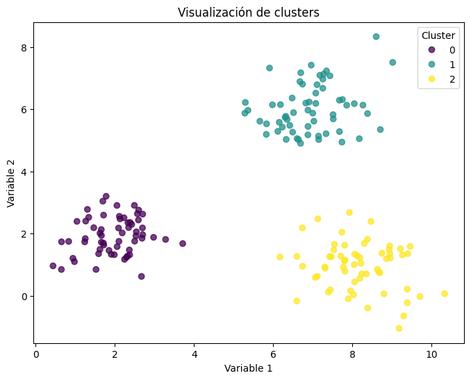

# Clustering: descubrir grupos en los datos

**Materia:** Ciencia de Datos  
**Tema:** aprendizaje no supervisado y análisis de clusters

> **Idea central:** un algoritmo de clustering propone grupos según una
> representación, una medida de similitud y ciertos supuestos. Los grupos no
> son etiquetas verdaderas por sí mismos: su utilidad depende de que sean
> interpretables, estables y relevantes para el problema.

## 1. Propósitos de aprendizaje

Al terminar esta guía, el estudiante podrá:

- explicar qué es el clustering y distinguirlo de la clasificación;
- describir los supuestos de K-Means, clustering jerárquico y DBSCAN;
- preparar variables para un algoritmo basado en distancias;
- comparar agrupamientos con medidas internas y criterios del dominio;
- comunicar límites e incertidumbre sin tratar los clusters como categorías
  naturales o causas.

## 2. ¿Qué es un cluster?

Un **cluster** o grupo reúne observaciones que son similares entre sí según
algún criterio y, idealmente, diferentes de las observaciones de otros grupos.
En una matriz de datos, cada fila suele ser una observación y cada columna una
característica (*feature*).

El **clustering** es una tarea de aprendizaje no supervisado: no se dispone de
una variable objetivo con las respuestas correctas durante el ajuste. El
algoritmo busca estructura en las características disponibles.

| Clasificación | Clustering |
| --- | --- |
| Usa ejemplos con etiquetas conocidas. | No requiere etiquetas conocidas para ajustar. |
| Aprende a predecir una clase definida. | Propone agrupamientos según los datos y el método. |
| Se evalúa comparando predicciones con etiquetas de referencia. | Se evalúa con estructura, estabilidad, utilidad y, si existen, referencias externas. |

Los identificadores de filas no son características. Tampoco conviene incluir
una etiqueta que luego se utilizará para interpretar los clusters: podría
dominar el agrupamiento y producir una conclusión circular.

## 3. El resultado depende de las decisiones

Antes de ajustar un modelo, hay que definir qué significa que dos
observaciones sean parecidas:

1. **Representación:** qué variables se incluyen y cómo se codifican.
2. **Preprocesamiento:** cómo se tratan faltantes, extremos y escalas.
3. **Medida de distancia o similitud:** por ejemplo, euclidiana, Manhattan o
   coseno.
4. **Algoritmo y parámetros:** forma esperada de los grupos, cantidad de
   grupos, densidad y otros ajustes.
5. **Criterio de utilidad:** qué patrón sería significativo para el dominio.

Por ello, diferentes decisiones pueden producir agrupamientos diferentes, sin
que uno sea automáticamente el correcto. Conviene justificar las decisiones y
comprobar si las conclusiones cambian bajo alternativas razonables.

### Preparar las características

- Selecciona variables que tengan sentido para la pregunta y elimina
  identificadores o columnas que codifiquen indirectamente la respuesta.
- Revisa valores faltantes, variables constantes, unidades y valores extremos.
  No imputes ni elimines observaciones sin considerar su significado.
- Codifica las variables categóricas de una manera compatible con la noción de
  similitud elegida. Codificar categorías como 0, 1, 2 puede introducir un
  orden y distancias que no existen.
- Escala variables numéricas cuando las magnitudes o unidades sean
  incompatibles y el algoritmo dependa de distancias. La estandarización no
  elimina la influencia de valores extremos y asigna un peso implícito a cada
  característica.
- Ajusta cualquier transformación únicamente con los datos de entrenamiento
  cuando evalúes generalización a datos nuevos.

## 4. Métodos de clustering

| Método | Idea | Ventajas | Limitaciones y parámetros |
| --- | --- | --- | --- |
| **K-Means** | Asigna cada observación al centroide más cercano y actualiza los centroides para reducir la suma de distancias cuadradas dentro de los grupos. | Sencillo y eficiente en muchos conjuntos grandes. | Hay que elegir `k`; depende de la escala e inicialización; es sensible a extremos y funciona mejor con grupos aproximadamente compactos. |
| **Jerárquico aglomerativo** | Empieza con cada observación como grupo y fusiona sucesivamente los grupos más cercanos. | El dendrograma permite explorar varios niveles de agrupamiento. | Puede ser costoso; el resultado depende de la distancia y del criterio de enlace (*linkage*). |
| **DBSCAN** | Encuentra regiones densas y puede marcar observaciones aisladas como ruido. | No exige especificar el número de grupos y puede encontrar formas no esféricas. | `eps` y `min_samples` son sensibles a la escala y a la densidad; puede tener dificultades con densidades muy distintas. |

### K-Means en más detalle

K-Means requiere elegir `k`, el número de grupos. En cada iteración asigna cada
punto al centroide más cercano y actualiza cada centroide como la media de sus
observaciones. Su objetivo habitual es reducir la suma de cuadrados dentro de
los clusters (inercia).

El algoritmo asigna un número de cluster a cada fila. El número es solo un
identificador: el cluster `0` no es menor, mejor ni más importante que el `1`.
Las etiquetas pueden cambiar entre ejecuciones sin que cambie la partición.

### Jerárquico y DBSCAN

En el método jerárquico, los criterios de enlace determinan la distancia entre
grupos. **Single linkage** usa la pareja más cercana; **complete linkage**, la
más lejana; y **average linkage**, la distancia promedio. El dendrograma muestra
el orden de fusiones y puede ayudar a seleccionar un corte, pero no decide por
sí mismo cuántos grupos son útiles.

DBSCAN define vecindades mediante `eps` y requiere un mínimo de vecinos
(`min_samples`) para considerar una región densa. Puede identificar puntos de
ruido con la etiqueta `-1`; estos no deben interpretarse como un cluster
ordinario.

## 5. Elegir y evaluar el número de clusters

No existe una regla universal que determine el número verdadero de clusters.
Se recomienda combinar varias perspectivas:

- **Inercia y método del codo:** mide la dispersión dentro de los grupos en
  K-Means. La inercia disminuye al aumentar `k`, incluso si se fragmentan
  grupos; busca cambios relevantes en la curva, no un mínimo absoluto.
- **Coeficiente silhouette:** compara para cada observación su distancia media
  a su propio cluster con la distancia media al cluster alternativo más
  cercano. Sus valores van aproximadamente de -1 a 1: valores altos sugieren
  separación y cohesión; valores cercanos a 0, solapamiento; y negativos,
  posibles asignaciones inadecuadas. Debe calcularse con una distancia
  compatible con el análisis y no sustituye la interpretación.
- **Estabilidad:** repite el análisis con otras inicializaciones o muestras y
  observa si los patrones principales se conservan.
- **Interpretabilidad y utilidad:** describe los perfiles de los grupos y
  comprueba si son relevantes para la pregunta científica o de negocio.

Las métricas internas evalúan propiedades geométricas del agrupamiento, no su
verdad ni su utilidad. Si hay etiquetas de referencia, pueden usarse métricas
externas para comparar, pero esas etiquetas no deben entrar inadvertidamente
en el ajuste.

## 6. Ejemplo reproducible: K-Means y silhouette

El siguiente ejemplo genera datos sintéticos de dos variables. Estandariza las
características, compara varios valores de `k` con silhouette y ajusta un
modelo final. En un conjunto real, sustituye la generación sintética por las
características previamente seleccionadas y revisadas.

```python
import matplotlib.pyplot as plt
import pandas as pd
from sklearn.cluster import KMeans
from sklearn.datasets import make_blobs
from sklearn.metrics import silhouette_score
from sklearn.preprocessing import StandardScaler

X, _ = make_blobs(
    n_samples=180,
    centers=3,
    cluster_std=0.9,
    random_state=42,
)
caracteristicas = ["variable_1", "variable_2"]
datos = pd.DataFrame(X, columns=caracteristicas)

escalador = StandardScaler()
X_escalado = escalador.fit_transform(datos[caracteristicas])

resultados = []
for k in range(2, 7):
    modelo = KMeans(n_clusters=k, n_init=10, random_state=42)
    etiquetas = modelo.fit_predict(X_escalado)
    resultados.append({
        "k": k,
        "inercia": modelo.inertia_,
        "silhouette": silhouette_score(X_escalado, etiquetas),
    })

tabla = pd.DataFrame(resultados)
print(tabla.round(3))

k_elegido = int(tabla.loc[tabla["silhouette"].idxmax(), "k"])
modelo = KMeans(n_clusters=k_elegido, n_init=10, random_state=42)
datos["cluster"] = modelo.fit_predict(X_escalado)

fig, ax = plt.subplots(figsize=(7, 5))
for cluster, grupo in datos.groupby("cluster"):
    ax.scatter(
        grupo["variable_1"],
        grupo["variable_2"],
        label=f"Cluster {cluster}",
        alpha=0.8,
    )
ax.set(
    title=f"K-Means con k={k_elegido}",
    xlabel="Variable 1",
    ylabel="Variable 2",
)
ax.legend()
plt.show()
```

El valor de `k` que maximiza silhouette es una sugerencia para este ejemplo,
no una respuesta automática. Compara también la inercia, visualiza los
perfiles y pregunta si las diferencias entre grupos son significativas para el
problema. En más de dos dimensiones, una proyección bidimensional puede
ayudar a visualizar, pero puede ocultar o distorsionar separaciones presentes
en el espacio original.

Una ilustración esquemática de tres grupos:



## 7. Interpretar y comunicar los resultados

Después de ajustar el modelo:

1. Resume cuántas observaciones hay en cada grupo.
2. Describe sus características con estadísticas apropiadas para cada
   variable; compara perfiles con el conjunto completo.
3. Revisa observaciones cercanas a fronteras y posibles puntos extremos.
4. Comprueba si los grupos son estables ante cambios razonables de escala,
   variables, inicialización o muestra.
5. Explica el método, las características, el preprocesamiento, los parámetros
   y el criterio usado para elegir el agrupamiento.

Evita afirmar que un cluster representa un tipo natural de persona, material o
fenómeno sin evidencia adicional. El clustering describe patrones en los datos
observados bajo unas decisiones concretas; no demuestra causalidad ni
garantiza que los grupos aparezcan de nuevo en otra población.

## 8. Actividad de discusión

Considera un conjunto de observaciones descritas por tamaño, densidad y una
categoría de material:

1. ¿Qué características incluirías para agrupar materiales con propiedades
   físicas similares? ¿Qué columna excluirías y por qué?
2. ¿Qué puede cambiar si tamaño se expresa en nanómetros en vez de
   micrómetros y no se escalan las variables?
3. ¿En qué situación elegirías DBSCAN en vez de K-Means?
4. Si silhouette mejora al aumentar `k`, ¿significa necesariamente que la
   partición con más clusters es más útil?
5. ¿Qué evidencia necesitarías antes de asignar un significado científico a
   cada grupo?

## 9. Ideas clave

- Un cluster es el resultado de una medida, una representación y un método;
  no una etiqueta verdadera descubierta automáticamente.
- La selección de características y el escalamiento pueden cambiar el
  resultado.
- K-Means, los métodos jerárquicos y DBSCAN responden a supuestos diferentes.
- Las métricas internas sirven para comparar agrupamientos, pero deben
  complementarse con estabilidad, interpretación y conocimiento del dominio.
- Los resultados deben comunicarse junto con sus decisiones y limitaciones.
